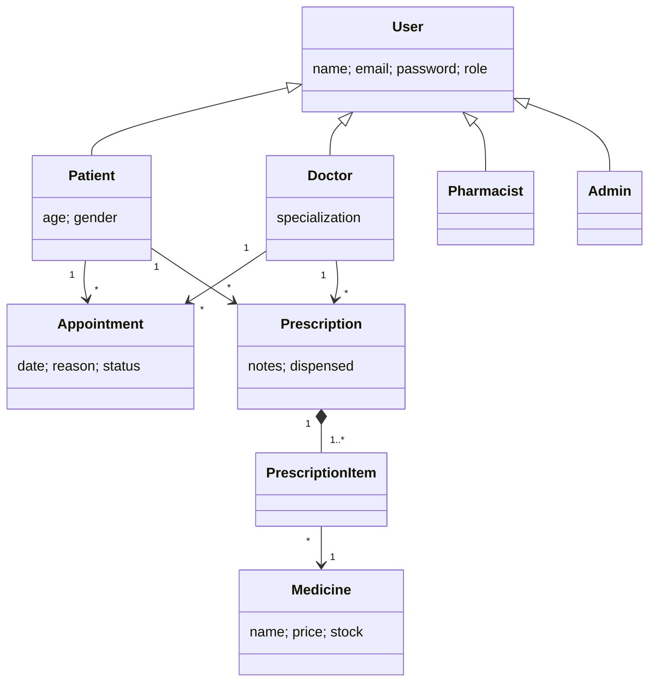

# CareLink – Hospital Management System (MERN)
## Run
1. Start MongoDB locally (or set `MONGO_URI`).
2. `cd server && npm install && npm start`  (API on :5000, seeds demo data)
3. `cd client && npm install && npm run dev`  (open the URL Vite prints)

Demo logins: admin@hms.com / admin123 · doctor@hms.com / doctor123 · pharmacy@hms.com / pharma123 · patients self-register.

## OOAD justification
**Actors and use cases.** Patient: register, book/cancel appointments, view prescriptions. Doctor: confirm/complete appointments, prescribe. Pharmacist: manage stock, dispense prescriptions. Admin: manage staff, view statistics and all records.

**Class diagram (Mermaid)**

**OO principles (server/models.js).** Abstraction: User hides credentials behind a common type. Inheritance and polymorphism: four roles extend User via Mongoose discriminators and are queried together or separately. Encapsulation: only the API layer touches the models; passwords are hashed and never returned. Composition: a Prescription owns its items, which reference Medicine.

**Design patterns (server/index.js).** Factory (`UserFactory`) creates the right subclass. State (`NEXT` table) restricts appointment status transitions. Chain of Responsibility (`auth` middleware: authenticate, then authorise by role, then handle). MVC separates models, Express routes and React views.

**SOLID/GRASP.** Single responsibility (models, auth, routes, UI components each have one job); Open/closed (a new role is one new subclass plus one factory entry); Low coupling and high cohesion (React `Form` and `Table` are reusable); Information expert (Prescription/Medicine rules such as stock checks are enforced where the data lives).

**Key scenario – dispense prescription.** Doctor creates Prescription → Pharmacist triggers dispense → system checks not already dispensed → checks stock for each item → decrements Medicine.stock → marks dispensed.
