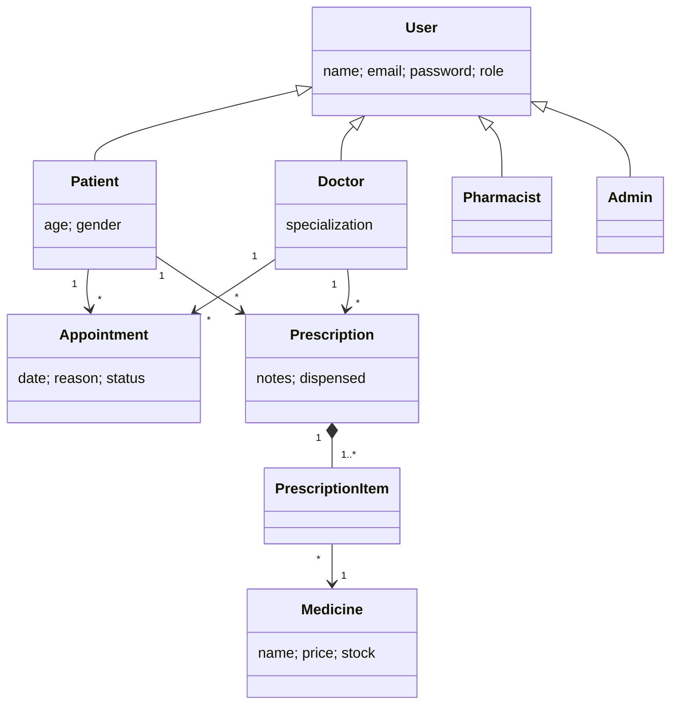

# CareLink – Hospital Management System (MERN)
## Run locally
1. Start MongoDB locally (or set `MONGO_URI`).
2. `cd server && npm install && npm start` (API on :5000, seeds demo data).
3. In another terminal, run `cd client && npm install && npm run dev` (open the URL Vite prints).

## Deploy (Render + Vercel)

Deploy the API as a Render **Web Service** and the React app as a Vercel **Project**. Create a MongoDB database (for example, MongoDB Atlas) and allow the Render service to connect to it.

### Render API

- Connect this repository and set **Root Directory** to `server`.
- **Build Command:** `npm install`
- **Start Command:** `npm start`
- Add environment variables:
  - `MONGO_URI`: your production MongoDB connection string.
  - `JWT_SECRET`: a long, unique random secret.
  - `CLIENT_ORIGIN`: set this to your Vercel deployment origin once it is available, such as `https://your-app.vercel.app` (no trailing slash). Multiple comma-separated origins are supported. It can be left unset while initially deploying; set it afterward and redeploy Render.

Render supplies `PORT` automatically. After deployment, copy the service URL, for example `https://your-api.onrender.com`.

### Vercel frontend

- Import the same repository as a Vercel project and set **Root Directory** to `client`.
- Vercel detects Vite; use **Build Command** `npm run build` and **Output Directory** `dist`.
- Add the environment variable `VITE_API_URL` with the Render service URL (for example `https://your-api.onrender.com`, without a trailing slash), then redeploy.
- Once the Vercel URL is known, set that exact URL as Render's `CLIENT_ORIGIN` and redeploy the Render service.

The frontend uses Vite's `/api` proxy only during local development; in production `VITE_API_URL` points requests to the Render API. Keep secrets such as `MONGO_URI` and `JWT_SECRET` in the hosting provider's environment settings, not in frontend variables.

Demo logins: admin@hms.com / admin123 · doctor@hms.com / doctor123 · pharmacy@hms.com / pharma123 · patients self-register.

## OOAD justification
**Actors and use cases.** Patient: register, book/cancel appointments, view prescriptions. Doctor: confirm/complete appointments, prescribe. Pharmacist: manage stock, dispense prescriptions. Admin: manage staff, view statistics and all records.

**Class diagram (Mermaid)**

**OO principles (server/models.js).** Abstraction: User hides credentials behind a common type. Inheritance and polymorphism: four roles extend User via Mongoose discriminators and are queried together or separately. Encapsulation: only the API layer touches the models; passwords are hashed and never returned. Composition: a Prescription owns its items, which reference Medicine.

**Design patterns (server/index.js).** Factory (`UserFactory`) creates the right subclass. State (`NEXT` table) restricts appointment status transitions. Chain of Responsibility (`auth` middleware: authenticate, then authorise by role, then handle). MVC separates models, Express routes and React views.

**SOLID/GRASP.** Single responsibility (models, auth, routes, UI components each have one job); Open/closed (a new role is one new subclass plus one factory entry); Low coupling and high cohesion (React `Form` and `Table` are reusable); Information expert (Prescription/Medicine rules such as stock checks are enforced where the data lives).

**Key scenario – dispense prescription.** Doctor creates Prescription → Pharmacist triggers dispense → system checks not already dispensed → checks stock for each item → decrements Medicine.stock → marks dispensed.
